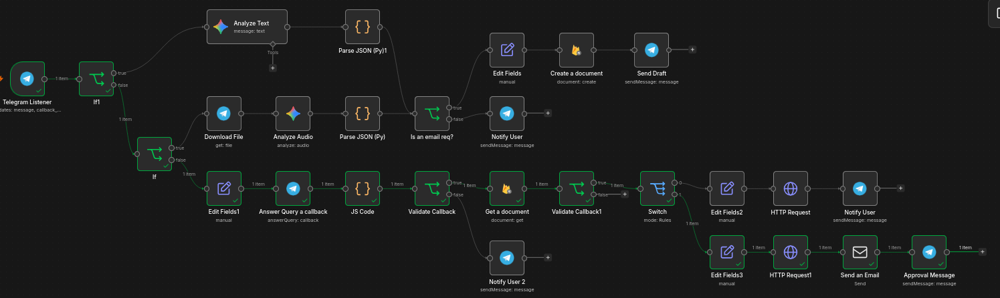

# Voice-to-Email AI Assistant

An AI-powered email automation workflow built with **n8n, Telegram, Google Gemini, Python, and Google Cloud Firestore**. The system transforms voice messages into structured email drafts, validates the generated content, and allows users to approve or cancel requests through Telegram before sending.

## Demonstration

### Chat Feature Demonstration
https://github.com/user-attachments/assets/902528e7-aad2-42ce-be42-0bcc9008b768

### Voice Feature Demonstration
https://github.com/user-attachments/assets/f9b14bda-42d2-4879-a60a-f6a7c38e09b6

---

## Workflow Screenshot

The following section will showcase the n8n automation workflow, including voice processing, AI-generated drafts, validation, Firestore persistence, and Telegram approval handling.



<!-- Place your workflow screenshot at screenshots/n8n-workflow.png, or update the path to match your repository. -->

## Features

- **Voice-based email requests:** Submit email instructions through Telegram voice messages.
- **AI-powered email drafting:** Uses Google Gemini to interpret voice instructions and generate structured email drafts.
- **Python validation:** Parses and validates the AI-generated JSON, checks required fields, and performs basic recipient email-format validation.
- **Human-in-the-loop approval:** Review the recipient, subject, and message body before deciding whether to proceed.
- **Approval and cancellation:** Use Telegram inline buttons to approve or cancel an email request.
- **Firestore persistence:** Stores email drafts, request metadata, and processing status in Google Cloud Firestore.
- **Request ownership checks:** Verifies that callback actions come from the user associated with the request.
- **Status management:** Updates request status through the Firestore REST API while preserving existing document fields.

## Tech Stack

| Technology | Purpose |
|---|---|
| [n8n](https://n8n.io/) | Workflow orchestration and automation |
| [Telegram Bot API](https://core.telegram.org/bots/api) | Voice input, draft previews, and approval buttons |
| [Google Gemini](https://ai.google.dev/) | Voice instruction interpretation and email drafting |
| Python | JSON parsing and validation logic |
| [Google Cloud Firestore](https://firebase.google.com/docs/firestore) | Draft persistence and request status management |
| Google Cloud service account | Authenticated access to Firestore |
| HTTP Request node | Firestore REST API updates |
| Email integration | Sending approved email drafts |

## How It Works

### 1. Voice Input

The user sends a voice message to the Telegram bot describing the email they want to write.

Example:

> Write an email to my colleague thanking them for helping me with the project.

### 2. AI-Powered Draft Generation

Google Gemini interprets the voice instruction and produces structured JSON containing fields such as:

- `is_email_request`
- `transcript`
- `recipient`
- `subject`
- `body`
- `needs_clarification`
- `clarification_question`

The workflow is designed to request clarification when essential information is missing rather than inventing recipient details or unsupported facts.

### 3. Python Validation

A Python validation step parses the model response and checks the required structure and fields. It also performs basic email-address format validation before a draft proceeds.

Invalid or incomplete requests are routed for clarification instead of continuing directly to approval.

### 4. Firestore Persistence

Valid drafts are saved to the `email_requests` collection in Firestore.

Each request has its own document ID, allowing callback actions to reference the correct draft.

Example document fields:

| Field | Description |
|---|---|
| `recipient` | Intended email recipient |
| `subject` | Email subject |
| `body` | Draft message body |
| `status` | Current request status |
| `telegram_user_id` | Telegram user associated with the request |
| `chat_id` | Telegram chat used for notifications |
| `created_at` | Draft creation timestamp |

### 5. Telegram Approval

The bot sends the generated email preview with inline buttons:

- **Approve:** Continue to the email-sending workflow.
- **Cancel:** Mark the request as cancelled.

Callback data contains the requested action and the associated request ID.

Before processing a callback, the workflow validates its structure, checks request ownership, and verifies that the request is still eligible for a decision.

### 6. Status Updates

The workflow uses the Firestore REST API through n8n's HTTP Request node to update request status.

An explicit update mask targets the intended field, while the request body preserves the existing email details.

The cancellation path updates the request to `CANCELLED`. The approval path is connected to an email-sending node and requires further end-to-end testing.

### 7. Email Delivery

After approval, the workflow proceeds to the configured email-sending node.

The intended lifecycle is:

`PENDING_APPROVAL` → `SENDING` → `SENT`

Cancelled requests use `CANCELLED`. Duplicate-send protection, failure handling, and delivery confirmation are areas for further refinement before production use.

## Example Firestore Document

The following is an illustrative example of a stored request:

```json
{
  "recipient": "recipient@example.com",
  "subject": "Project Update",
  "body": "Hello, here is the latest project update...",
  "status": "PENDING_APPROVAL",
  "telegram_user_id": "TELEGRAM_USER_ID",
  "chat_id": "TELEGRAM_CHAT_ID",
  "created_at": "2026-10-16T08:00:00.000Z"
}
```

This is an example only and does not represent an actual email request.

## Security Considerations

- Keep Telegram bot tokens, Google Cloud service-account credentials, and email credentials out of source control.
- Use n8n credentials or environment variables to manage secrets.
- Validate callback data and verify request ownership before changing request status.
- Check the current request status before processing approval callbacks.
- Do not send an email solely because a callback contains an `approve` action.
- Implement duplicate-send protection and failure handling before relying on the workflow in production.
- Use test accounts and non-sensitive messages during development.
- Remove private URLs, personal information, and credentials from workflow exports and screenshots before publishing.

## Setup Overview

This project is designed to run in an n8n environment with the necessary integrations configured.

1. Install or deploy n8n.
2. Create a Telegram bot and configure its credentials in n8n.
3. Configure access to Google Gemini.
4. Create a Google Cloud project and enable Firestore.
5. Configure a service account with the minimum required Firestore permissions.
6. Configure the email-sending credentials for the chosen email provider.
7. Import or recreate the n8n workflow and configure the required node expressions and connections.
8. Test voice processing, validation, approval, cancellation, and status persistence using a test account.

Exact setup requirements depend on the workflow export and credential configuration. Credentials must be configured separately and should never be included in a public workflow export.


## Future Improvements

- Add robust duplicate-send protection and idempotent request processing.
- Improve email-sending failure handling and Telegram notifications.
- Add an audit trail for approval decisions and delivery outcomes.
- Improve retry handling for transient API errors.
- Support multiple email providers.
- Add automated tests for validation and callback processing.
- Improve observability through structured logs and execution monitoring.

## What I Learned

This project explores practical AI automation beyond text generation. It combines AI-generated structured output, Python validation, event-driven workflows, database persistence, callback handling, and user-controlled execution.

It also demonstrates the importance of validating user actions, preserving stored data during updates, and designing automation workflows that can recover safely from errors.

---

Built as a hands-on project in AI-assisted workflow automation using n8n, Python, Telegram, and Google Cloud Firestore.
